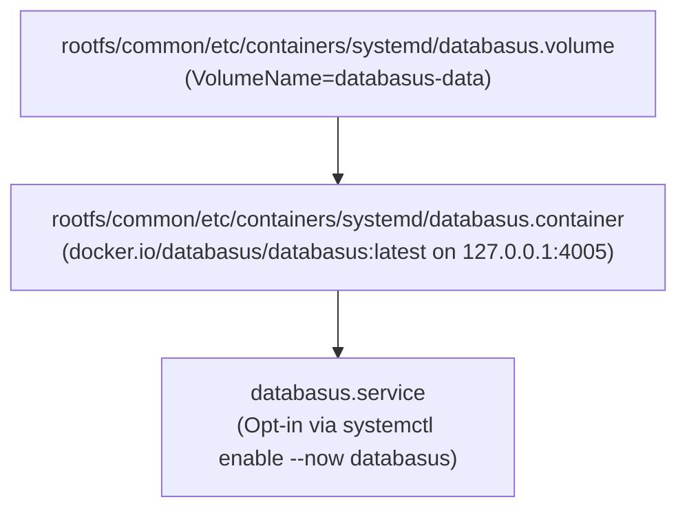

# Backup Architecture: Current and Target State

This document outlines the backup infrastructure for hosts running images built from this repository. The legacy wrapper units and build stages have been retired in favor of a decoupled backup strategy utilizing Restic and Databasus (`borgbackup` remains installed solely to read and migrate existing Borg repositories).

---

## Architectural Comparison

| Dimension | Legacy State (Retired) | Current State (Restic + Databasus) |
| :--- | :--- | :--- |
| **Primary Engine (Files/Appdata)** | Legacy Borg wrapper (`borgbackup` retained for migration) | **Restic** |
| **Primary Engine (Databases)** | Monolithic internal database dump hooks | **Databasus** |
| **Package Management** | Compiled Python wheel in multi-stage build (retired) | Standalone Go binaries & dedicated quadlet containers |
| **Systemd Units** | Legacy host timer/service units (removed from `rootfs/common/`) | System/user quadlets (`databasus.container`, `databasus.volume`) & restic systemd timers |
| **SELinux Integration** | Custom SELinux policy module (removed) | Standard container/system policies |
| **Repository Backend** | SSH Borg repositories / local drives | S3-compatible object storage, B2, or local storage |
| **Status** | Retired (`borgbackup` CLI kept for repo migration) | Active |

---

## Current State: Central Database Backups (Databasus) & Restic

The active backup architecture decouples stateful database dumps from general filesystem and application data snapshots:

### 1. Build Stage Integration
In [Containerfile](Containerfile):
- The legacy Python wrapper builder stage has been removed.
- System packages retained in the `final` stage include `borgbackup` (for validating and migrating existing Borg archives), `rclone`, and `rsync`.

### 2. System Quadlet Units
Installed in `rootfs/common/etc/containers/systemd/`:
- **`databasus.volume`**:
  - Provisions the persistent `databasus-data` Podman volume (`VolumeName=databasus-data`).
- **`databasus.container`**:
  - Runs `docker.io/databasus/databasus:latest` mounted at `/databasus-data`.
  - Publishes the web UI strictly on `127.0.0.1:4005:4005` because the UI stores database credentials.
  - Shipped opt-in (`WantedBy=default.target`); operators enable it on the central backup host via `systemctl enable --now databasus`.

### 3. SELinux Policy
- Custom backup SELinux modules and `.github/workflows/selinux.yml` have been retired; Databasus runs under standard Podman container SELinux confinement.

---

## Target State: Restic + Databasus Migration

The architecture decouples general filesystem and application data backups from stateful database backups.

### 1. Restic for Files and Appdata (Implemented in Base Image)
- **Purpose**: Fast, secure, deduplicated backups of host directories (`/etc`, `/var`, `/home`) and application data (`/home/*/appdata`).
- **Advantages over Legacy Wrapper**:
  - Native Go binary (`/usr/bin/restic`, installed via EPEL in [Containerfile](Containerfile)) with no Python or C-extension runtime dependencies.
  - Native first-class support for cloud object storage (S3, Backblaze B2, MinIO, Azure) and local repositories without relying on SSH bridges or local FUSE mounts.
  - Significantly faster index traversal and snapshot operations.
- **Implementation (Shipped in Base Image)**:
  - **Package**: `restic` installed directly in the `final` stage of [Containerfile](Containerfile).
  - **Backup Wrapper**: [`rootfs/common/usr/libexec/coreos/restic-backup.sh`](../rootfs/common/usr/libexec/coreos/restic-backup.sh) (mode `0755`) loads `/etc/restic/env`, fails closed if `RESTIC_REPOSITORY` is unset, reads the encrypted systemd credential `${CREDENTIALS_DIRECTORY}/restic.pw` (or falls back to `RESTIC_PASSWORD_FILE`), auto-initializes uninitialized repositories via `restic init`, backs up `$BACKUP_PATHS` (default `/etc /var /home` plus any existing `/home/*/appdata` directories) with `--exclude-file=/etc/restic/excludes.txt` and `--host "$(hostname)"`, and applies retention pruning (`restic forget --keep-daily 7 --keep-weekly 4 --keep-monthly 6 --prune`).
  - **Configuration & Excludes**:
    - [`rootfs/common/etc/restic/env`](../rootfs/common/etc/restic/env) (installed to `/etc/restic/env`, mode `0600`): Secret-free configuration template defining `RESTIC_REPOSITORY=`, optional `RESTIC_PASSWORD_FILE`, `RESTIC_OPTIONS`, and `BACKUP_PATHS`.
    - [`rootfs/common/etc/restic/excludes.txt`](../rootfs/common/etc/restic/excludes.txt) (installed to `/etc/restic/excludes.txt`): Default exclusion rules for caches and ephemeral/reproducible paths (`/var/cache`, `/var/tmp`, `/var/lib/containers/storage`, `/var/lib/nix`, `/var/lib/systemd/random-seed`, `/var/lib/machine-id`, `**/.cache`, `**/lost+found`, `/nix`).
  - **Systemd Units**:
    - [`rootfs/common/usr/lib/systemd/system/restic-backup.service`](../rootfs/common/usr/lib/systemd/system/restic-backup.service) (`restic-backup.service`): `Type=oneshot` service with `ConditionACPower=true`, `LoadCredentialEncrypted=restic.pw`, `EnvironmentFile=-/etc/restic/env`, batch CPU/IO scheduling priority, `ExecStartPre=sleep 1m`, and `ExecStart=/usr/libexec/coreos/restic-backup.sh`.
    - [`rootfs/common/usr/lib/systemd/system/restic-backup.timer`](../rootfs/common/usr/lib/systemd/system/restic-backup.timer) (`restic-backup.timer`): Fires daily at `04:30:00` (`Persistent=true`), offset from Borgmatic's `04:00:00` schedule.
  - **Opt-In Activation**: `restic-backup.timer` is **not enabled by default** in the image. Nothing runs until an operator configures `/etc/restic/env`, provisions the `restic.pw` credential (via `systemd-creds encrypt`), and enables the timer (`systemctl enable --now restic-backup.timer`).

### 2. Databasus for Databases
- **Purpose**: Dedicated, isolated database dump management and snapshotting for relational and document engines (PostgreSQL, MySQL, MariaDB, MongoDB).
- **Advantages over Monolithic Hooks**:
  - Avoids running database client dump hooks inside the monolithic host backup process.
  - Runs as an independent container service (`rootfs/common/etc/containers/systemd/databasus.container`) with native database connection management, compression, verification, and rotation.
  - Consistent point-in-time recovery without locking the entire host filesystem snapshot.

---

## Migration Guidelines for Agents

When implementing changes or transitioning systems:

1. **Keep `borgbackup` Package Until Repository Migration Completes**:
   - The legacy systemd units, SELinux module, and builder stage are retired, but the `borgbackup` RPM must remain installed in `Containerfile` and `build/justfile` so existing Borg repositories can be inspected and migrated.
2. **Central Databasus Opt-In**:
   - Keep `databasus.container` opt-in and bound to `127.0.0.1:4005` so only designated backup hosts run the central database backup UI.
3. **Appdata Consistency**:
   - Ensure that application quadlets and database containers expose standard dump volumes or database ports accessible by Databasus prior to filesystem snapshotting.
