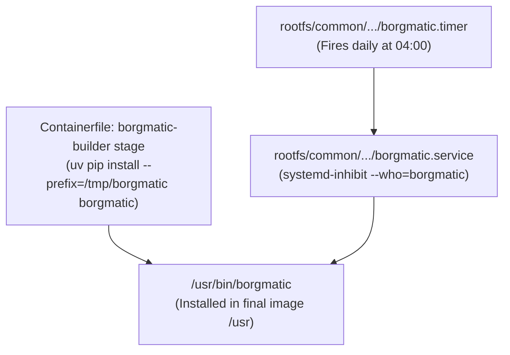

# Backup Architecture: Current and Target State

This document outlines the backup infrastructure for hosts running images built from this repository. A migration is actively in progress to phase out Borgmatic in favor of a modern, decoupled backup strategy utilizing Restic and Databasus.

---

## Architectural Comparison

| Dimension | Current State | Target State (Migration in Progress) |
| :--- | :--- | :--- |
| **Primary Engine (Files/Appdata)** | Borgmatic (`borgbackup`) | **Restic** |
| **Primary Engine (Databases)** | Borgmatic internal database dump hooks | **Databasus** |
| **Package Management** | Compiled Python wheel via `uv` in multi-stage build | Standalone Go/Rust binaries or dedicated quadlet containers |
| **Systemd Units** | `borgmatic.service`, `borgmatic.timer` in `rootfs/common/` | User/system quadlets & restic systemd timers |
| **SELinux Integration** | Custom SELinux policy module (`build/selinux/borgmatic/`) | Standard container/system unconfined policies |
| **Repository Backend** | SSH Borg repositories / local drives | S3-compatible object storage, B2, or local storage |
| **Status** | Active / Legacy | In development / Phasing in |

---

## Current State: Borgmatic Architecture

The current backup solution relies on Borgmatic wrapper scripts and systemd orchestration:



### 1. Build Stage Integration
In [Containerfile](Containerfile#L30-L35):
- A dedicated multi-stage build stage `borgmatic-builder` inherits from `base`.
- Installs `gcc` and `python3-devel`.
- Uses Astral `uv` to build Borgmatic into `/tmp/borgmatic`:
  ```dockerfile
  FROM base AS borgmatic-builder
  RUN dnf install -y gcc python3-devel && \
      mkdir /var/roothome && \
      uv pip install --prefix=/tmp/borgmatic borgmatic
  ```
- The `final` stage copies the built prefix into the root filesystem:
  ```dockerfile
  COPY --from=borgmatic-builder /tmp/borgmatic /usr
  ```
- Backed by system packages: `borgbackup`, `rclone`, and `rsync`.

### 2. Systemd Service and Timer
Installed in `rootfs/common/usr/lib/systemd/system/`:
- **`borgmatic.timer`**:
  - Triggers daily at 04:00 AM with persistence (`Persistent=true`).
  - Activates `borgmatic.service`.
- **`borgmatic.service`**:
  - Type: `oneshot`.
  - Condition: `ConditionACPower=true` (prevents battery depletion on mobile devices).
  - Security credentials: `LoadCredentialEncrypted=borgmatic.pw`.
  - Priority: `Nice=19`, `CPUSchedulingPolicy=batch`, `IOSchedulingClass=best-effort`.
  - Execution wrapper: Uses `systemd-inhibit --who="borgmatic" --what="sleep:shutdown" --why="Prevent interrupting scheduled backup" /usr/bin/borgmatic --verbosity -2 --syslog-verbosity 1` with an initial `ExecStartPre=sleep 1m` settling delay.

### 3. SELinux Policy Module
- Located in `build/selinux/borgmatic/`.
- Compiles custom SELinux policy (`borgmatic.te`, `borgmatic.fc`, `borgmatic.if`) to permit borgmatic to inspect files across varying filesystem labels and interact with system credentials.

---

## Target State: Restic + Databasus Migration

The target state decouples general filesystem and application data backups from stateful database backups.

### 1. Restic for Files and Appdata
- **Purpose**: Fast, secure, deduplicated backups of host directories (`/etc`, `/var`, `/home`) and application data (`/home/*/appdata`).
- **Advantages over Borgmatic**:
  - Native Go binary with no Python or C-extension runtime dependencies.
  - Native first-class support for cloud object storage (S3, Backblaze B2, MinIO, Azure) without relying on SSH bridges or local FUSE mounts.
  - Significantly faster index traversal and snapshot operations.
- **Implementation**:
  - Standalone binary packaged directly or pulled via container.
  - Scheduled via user-level or system-level systemd timers running rootless where appropriate.

### 2. Databasus for Databases
- **Purpose**: Dedicated, isolated database dump management and snapshotting for relational engines (PostgreSQL, MySQL, SQLite, MariaDB).
- **Advantages over Borgmatic Hooks**:
  - Avoids running database client dump hooks inside the monolithic host backup process.
  - Runs as an independent container service with native database connection management, compression, verification, and rotation.
  - Consistent point-in-time recovery without locking the entire host filesystem snapshot.

---

## Migration Guidelines for Agents

When implementing changes or transitioning systems:

1. **Do Not Prematurely Remove Borgmatic Units**:
   - Both `borgmatic.service` and `borgmatic.timer` must remain intact in `rootfs/common/` until Restic and Databasus deployments are verified in production.
2. **Phase Out `borgmatic-builder`**:
   - Once all host targets switch to Restic, remove the `borgmatic-builder` multi-stage block in [Containerfile](Containerfile) and clean up `build/selinux/borgmatic/`.
3. **Appdata Consistency**:
   - Ensure that application quadlets and database containers expose standard dump volumes or database ports accessible by Databasus prior to filesystem snapshotting.
