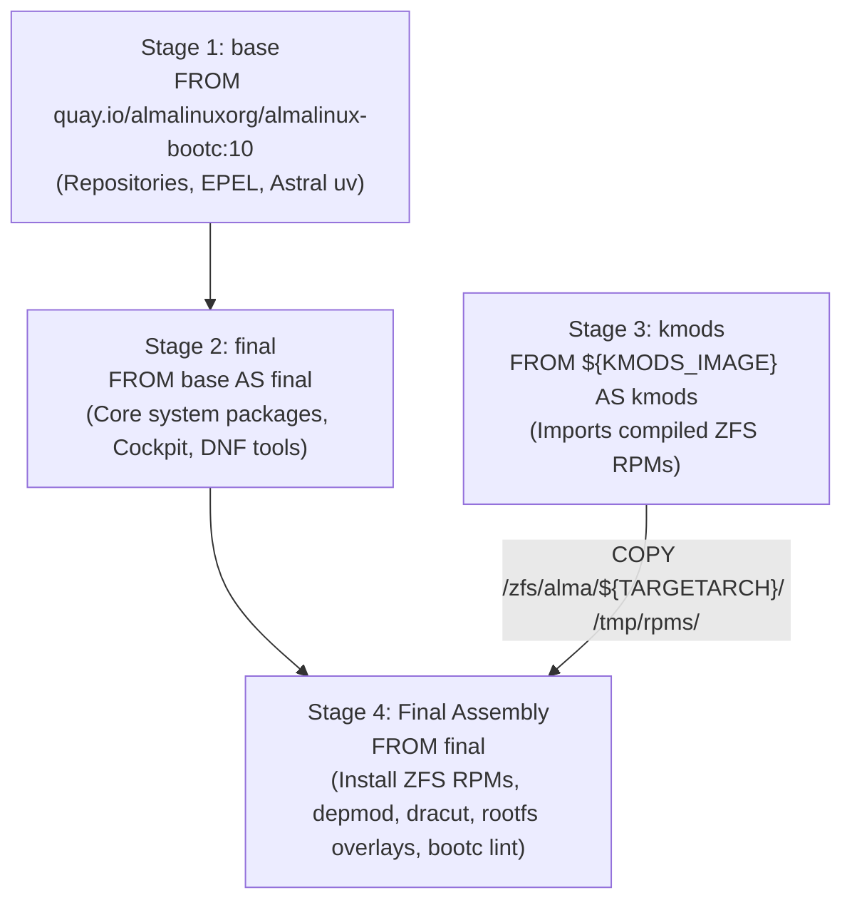
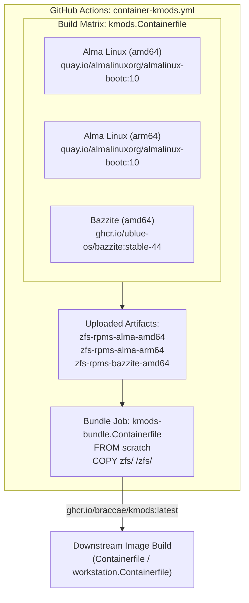

# Build System Architecture

This document describes the multi-stage Containerfile build pipelines, bootc validation mechanics, the kernel module distribution subsystem, internal build automation scripts, configuration files, and disk image generation recipes.

---

## Multi-Stage Containerfile Patterns

Multi-staging is utilized extensively across the repository to keep deployment container images minimal, decouple build tooling from runtime environments, and manage external dependencies cleanly.

### 1. Base AlmaLinux Multi-Stage Pipeline ([Containerfile](Containerfile))
The primary base image uses a four-stage build pipeline:



Key stages:
- **`base`**: Initializes upstream AlmaLinux 10 repositories, EPEL, RPM Fusion, and installs Astral `uv` for isolated Python tool compilation.
- **`final`**: Installs core systemd services, Cockpit modules, and virtualization drivers.
- **`kmods`**: Parameterized import stage driven by `ARG KMODS_IMAGE=localhost/kmods:latest`.
- **Final Assembly**: Copies kernel modules for the target architecture (`$TARGETARCH`), performs a kernel version compatibility check against `/tmp/rpms/kernel-version.txt`, installs the matching ZFS RPMs, executes `depmod -a`, runs `dracut -f`, copies filesystem overlays (`rootfs/non_btrfs/`, `rootfs/common/`), and runs `bootc container lint`.

### 2. Docker Host Multi-Stage Pipeline ([dockerhost.Containerfile](dockerhost.Containerfile))
- **Stage 1 (`base`)**: `FROM ghcr.io/braccae/alma:latest as base`.
- **Stage 2 (`builder`)**: Installs compilation dependencies (`nodejs`, `make`, `rpm-build`, `libappstream-glib`), clones `https://github.com/chabad360/cockpit-docker.git`, and builds the cockpit-docker RPM via `NODE_ENV=production make rpm`.
- **Stage 3 (`final`)**: Configures the upstream Docker CE repository, installs Docker engine packages, and installs the compiled Cockpit Docker RPM from the builder stage via a bind mount (`--mount=type=bind,from=builder,...`).

---

## Bootc Container Lint

Every bootable container image intended for bare-metal or virtualized installation must pass bootc validation during build time:

```dockerfile
RUN bootc container lint
```

Present in:
- [Containerfile](Containerfile#L166)
- [dx.Containerfile](dx.Containerfile#L15)
- [hci.Containerfile](hci.Containerfile#L89)
- [k3s.Containerfile](k3s.Containerfile#L34)
- [workstation.Containerfile](workstation.Containerfile#L69)

### Verification Contract
`bootc container lint` ensures the image adheres to the bootable container specification:
- `/usr` contains valid kernel modules and initramfs files matching the active kernel.
- State directories like `/var` and configuration directories like `/etc` are structured for ostree 3-way merging.
- No invalid hardlinks cross boundary directories.
- System initialization entries (such as `/sbin/init` or `/usr/lib/systemd/systemd`) are configured as valid entrypoints.

---

## Kernel Modules Architecture: `kmods.Containerfile` and `kmods-bundle.Containerfile`

Because upstream bootc distributions update kernels independently, kernel modules (specifically OpenZFS) cannot be compiled generically. This repository decouples kmod building from base image builds.



### 1. `kmods.Containerfile`
- **Base**: `ARG BASE_IMAGE=quay.io/almalinuxorg/almalinux-bootc:10`
- **Mechanism**: Copies the MOK public key (`keys/mok/LOCALMOK.der`) and mounts the MOK private signing key via Buildah secret `--secret id=LOCALMOK`.
- Runs `build/scripts/build-zfs.sh` to compile OpenZFS against the specific kernel version in `BASE_IMAGE` and signs the resulting kernel modules.
- Records the compiled kernel version into `/tmp/zfs-rpms/kernel-version.txt`.
- Outputs a minimal scratch image containing `/zfs/`.

### 2. `kmods-bundle.Containerfile`
- Contains:
  ```dockerfile
  FROM scratch
  COPY zfs/ /zfs/
  ```
- In GitHub Actions (`.github/workflows/container-kmods.yml`), the `bundle` job downloads all matrix artifacts into:
  - `zfs/alma/amd64/`
  - `zfs/alma/arm64/`
  - `zfs/bazzite/amd64/`
- Assembles them into a single distribution image: `ghcr.io/braccae/kmods:latest`.

### 3. The `KMODS_IMAGE` Build ARG and Safe Ingestion
Downstream builds declare:
```dockerfile
ARG KMODS_IMAGE=localhost/kmods:latest
FROM ${KMODS_IMAGE} AS kmods
FROM final
ARG TARGETARCH
COPY --from=kmods /zfs/alma/${TARGETARCH}/ /tmp/rpms/
```
During assembly, the build verifies that the kernel version for which the kmod was built matches the running container's kernel:
```bash
if [ -f /tmp/rpms/kernel-version.txt ]; then
    KMOD_KERNEL=$(cat /tmp/rpms/kernel-version.txt)
    CURRENT_KERNEL=$(basename /lib/modules/*)
    if [ "$CURRENT_KERNEL" = "$KMOD_KERNEL" ]; then
        dnf install -y /tmp/rpms/*.rpm
        depmod -a --filesyms /usr/lib/modules/${CURRENT_KERNEL}/System.map ${CURRENT_KERNEL}
    else
        echo "WARNING: Kernel version mismatch! Skipping ZFS installation."
    fi
fi
```
If the kernel versions do not match, the build logs a warning and skips ZFS installation rather than producing an unbootable or broken image.

---

## Build Automation: `build/justfile`

The [build/justfile](build/justfile) contains specialized modular recipes invoked inside the container build context (especially by Bazzite images):

- `get-active-kernel`: Finds the active kernel release directory under `/usr/lib/modules/*/` containing `vmlinuz`.
- `get-active-kernel-base`: Extracts the semver base string of the active kernel.
- `install-ublue-repos`: Configures external package repositories including Terra, GitHub CLI (`gh`), VS Code, and Ghostty terminal.
- `install-ansible`: Installs the Ansible automation engine, linter, and core collections.
- `install-java`: Installs OpenJDK 21 headless/runtime packages.
- `install-kde-utils`: Installs KDE desktop utilities, Discover package management plugins, Konsole, and Qt6 dependencies.
- `install-misc-tools`: Installs operational utilities (`tailscale`, `zsh`, `rclone`, `borgbackup`, `samba`, `bat`, `bees`).
- `install-game-mode`: Enables COPR repository and installs XIVLauncher.
- `install-virt-tools`: Installs QEMU/KVM userland tools, `virt-manager`, and virtio graphics drivers.
- `install-dev-mode`: Installs development tools (Visual Studio Code, `pnpm`, `nodejs`, `gh`).

---

## Build Scripts: `build/scripts/`

The [build/scripts/](build/scripts/) directory houses reusable shell and Python scripts:

- **`build-zfs.sh`**: Clones and builds OpenZFS RPMs. Auto-detects kernel header locations, configures kmod build parameters, generates RPM packages, and signs all `.ko` binaries using the provided MOK private key.
- **`get-latest-release.sh`**: Queries GitHub API to locate and download release assets by substring matching (used in [hci.Containerfile](hci.Containerfile) to fetch 45Drives Cockpit plugin RPMs).
- **`validate-selinux.py`**: Python script that parses targeted SELinux policies using `setfiles -c`. Tests policy files line-by-line against the system file context database to identify and isolate policy syntax errors before image deployment.
- **`wazuh-agent.sh`**: Configures Wazuh repositories and installs the host security agent.

---

## Disk and Installer Image Configurations

Located in `build/`, these TOML configuration files define how `quay.io/centos-bootc/bootc-image-builder:latest` partitions and initializes bare-metal and VM disk images:

### 1. `build/config-img.toml` (VM Disk Configuration)
Used when generating `.qcow2` virtual machine disks:
```toml
[[customizations.user]]
name = "core"
key = "ssh-ed25519 AAAAC3NzaC1lZDI1NTE5AAAAIBa+WBLGQyn4d/0y0Z2YIB/C7FXO0b7lGveWSAA3A7Zj"
groups = ["wheel"]

[[customizations.filesystem]]
mountpoint = "/"
minsize = "16 GiB"
```
Configures the default administrative user (`core`), injects the authorized Ed25519 public SSH key, grants passwordless sudo access via the `wheel` group, and sets a minimum root filesystem boundary of 16 GiB.

### 2. `build/config-iso.toml` (Installer ISO Configuration)
Used when generating bare-metal Anaconda bootc installation media:
```toml
[customizations.installer.modules]
enable = [
  "org.fedoraproject.Anaconda.Modules.Storage",
  "org.fedoraproject.Anaconda.Modules.Runtime",
  "org.fedoraproject.Anaconda.Modules.Network",
  "org.fedoraproject.Anaconda.Modules.Security",
  "org.fedoraproject.Anaconda.Modules.Services",
  "org.fedoraproject.Anaconda.Modules.Users",
  "org.fedoraproject.Anaconda.Modules.Timezone"
]

disable = [
  "org.fedoraproject.Anaconda.Modules.Subscription",
]
```
Enables essential Anaconda installer modules for automated storage partitioning, network initialization, and user creation, while explicitly disabling Red Hat enterprise subscription prompts.

---

## The `build-disk-image` Recipe

Defined in [justfile](justfile#L56), this recipe encapsulates the call to `bootc-image-builder`:

```bash
just build-disk-image [image='alma'] [image_tag='latest']
```

### Exact Execution Sequence
```bash
sudo podman pull ghcr.io/braccae/{{image}}:{{image_tag}}
sudo mkdir -p ./output/{{image}}/{{image_tag}}
sudo podman run \
    --rm \
    -it \
    --privileged \
    --pull=newer \
    --security-opt label=type:unconfined_t \
    -v ./build/config-img.toml:/config.toml:ro \
    -v ./output/{{image}}/{{image_tag}}:/output \
    -v /var/lib/containers/storage:/var/lib/containers/storage \
    quay.io/centos-bootc/bootc-image-builder:latest \
    --type qcow2 \
    --use-librepo=True \
    --rootfs xfs \
    ghcr.io/braccae/{{image}}:{{image_tag}}
sudo chown -fR ${SUDO_UID:-${CALLING_UID:-$(id -u)}}:${SUDO_GID:-${CALLING_GID:-$(id -g)}} ./output
```

Key arguments:
- `--privileged` & `--security-opt label=type:unconfined_t`: Required because `bootc-image-builder` creates loopback devices and mounts disk partitions inside the builder container.
- `-v /var/lib/containers/storage:/var/lib/containers/storage`: Reuses the host's container image cache, preventing repeated multi-gigabyte downloads.
- `--type qcow2`: Emits a QEMU copy-on-write disk image under `./output/<image>/<image_tag>/qcow2/disk.qcow2`.
- `--rootfs xfs`: Formats the sysroot with XFS (matching `rootfs/non_btrfs/` configuration).
- The companion recipe `just build-iso` uses `--type bootc-installer`, `--rootfs btrfs`, and `build/config-iso.toml`.
