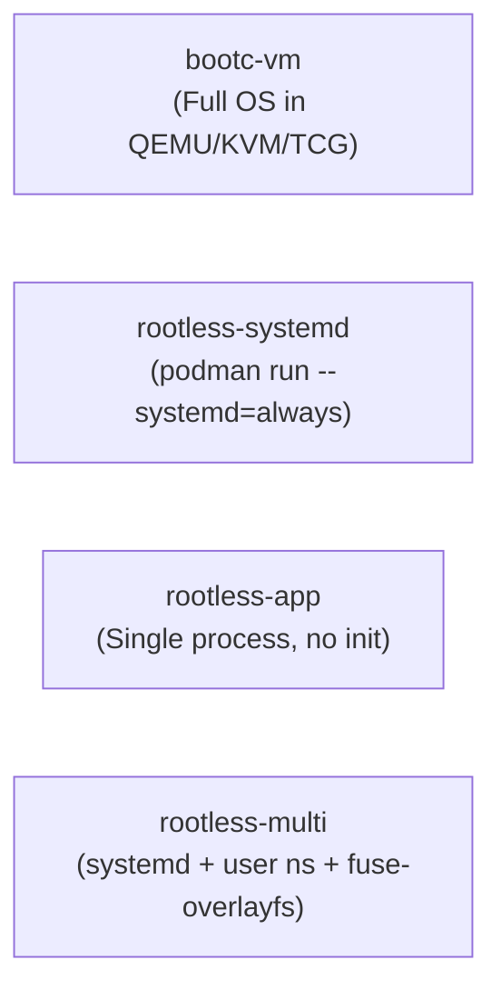

# Testing and Verification Guide

This document defines the 4 run-mode validation contract, explicit acceptance criteria for each mode, local reproduction constraints, and automated verification procedures.

---

## The 4 Run-Mode Contract

Every image or configuration change must be validated against its targeted execution model. The repository supports four distinct runtime modes:



---

### 1. `bootc-vm` (Bare-Metal / Full OS VM Mode)

- **Description**: Boots the built `.qcow2` disk image inside a virtual machine running a virtual UEFI firmware, validating full operating system initialization, kernel module loading, systemd targets, and networking.
- **Execution Target**:
  - **Locally**: Accelerated hardware virtualization via KVM using `just test-vm` (recipes defined in [justfile](justfile)).
  - **In CI**: Software emulation via QEMU TCG (`--accel tcg`) where hardware nested virtualization is unavailable.
- **Acceptance Criteria**:
  1. **UEFI Boot**: Firmware successfully locates the EFI bootloader (`systemd-boot` or GRUB) and executes the installed kernel and initramfs without kernel panics.
  2. **System Target**: Systemd transitions cleanly to `multi-user.target` without critical service failures (`systemctl is-system-running` returns `running` or `degraded` due only to expected unconfigured cloud metadata).
  3. **Console Accessibility**: Serial console (`virsh console <vm_name>`) and VNC display provide an interactive login prompt.
  4. **Network & SSH**: The virtual network interface acquires a DHCP lease; user `core` can authenticate via the pre-seeded Ed25519 SSH key.
  5. **Bootc Status**: Running `bootc status` inside the VM recognizes the booted ostree deployment without errors.
  6. **Module Verification**: If testing ZFS/kmods, `lsmod | grep zfs` confirms kernel modules are cleanly loaded and signed.

---

### 2. `rootless-systemd` (Containerized Systemd as Unprivileged User)

- **Description**: Runs the container image under rootless Podman with systemd enabled as PID 1 (`podman run --systemd=always`) under a normal, non-root user account.
- **Typical Use Case**: The [webtop.Containerfile](webtop.Containerfile) desktop container or service quadlets.
- **Execution Command**:
  ```bash
  podman run -d \
      --name test-systemd \
      --systemd=always \
      --device /dev/dri \
      -p 3000:3000 \
      localhost/<image>:latest
  ```
- **Acceptance Criteria**:
  1. **Privilege Boundary**: Container starts **without** the `--privileged` flag.
  2. **PID 1 Execution**: Systemd starts successfully as PID 1 without permission errors on `/sys`, `/proc`, or cgroups.
  3. **Capability Stripping**: Security restrictions (like `no_new_privs`) do not break user session setup.
  4. **Service Health**: Contained systemd services (e.g. `webtop.service`, web proxies) start and remain active.
  5. **Network / Port Binding**: Exposed ports (such as port 3000 for Selkies) bind properly on the unprivileged user network namespace.

---

### 3. `rootless-app` (Single Application Container)

- **Description**: Runs a single application or process in a rootless container without invoking systemd and without running an init process as PID 1.
- **Typical Use Case**: Ephemeral CLI commands, data processors, automated test runners, or simple microservice quadlets.
- **Execution Command**:
  ```bash
  podman run --rm -it localhost/<image>:latest <command>
  ```
- **Acceptance Criteria**:
  1. **Zero Init Overhead**: Entrypoint bypasses `/sbin/init` or `/usr/lib/systemd/systemd`, launching the process immediately.
  2. **User Namespace Mapping**: Process runs under the assigned rootless UID/GID mapping without host permission escalation.
  3. **Clean Process Termination**: Process receives standard POSIX signals (`SIGTERM`, `SIGINT`) and exits with code 0 without hanging or leaving zombie subprocesses.
  4. **Log Streaming**: Standard output and error stream directly to the terminal or container log collector.

---

### 4. `rootless-multi` (Multi-Process User Namespace with `fuse-overlayfs`)

- **Description**: Multi-process container or nested container runtime operating under an unprivileged user account using user namespaces, subuids/subgids, and `fuse-overlayfs` for container storage.
- **Typical Use Case**: Nested Podman within Alma developer images ([dx.Containerfile](dx.Containerfile), `rootfs/common/etc/containers/containers.conf.d/20-nested.conf`).
- **Configuration Contract**:
  - Subuid/subgid allocation configured via `/usr/sbin/setup-podman-user <user> <id>`.
  - Storage driver set to `fuse-overlayfs` with `additionalimagestores = ["/var/lib/host-containers"]`.
  - Cgroup manager set to `cgroupfs` and `label = false` in nested container configs.
  - User lingering enabled (`loginctl enable-linger <user>`).
- **Acceptance Criteria**:
  1. **Storage Mounting**: Unprivileged user can mount and unmount `fuse-overlayfs` storage without kernel permission denials.
  2. **Nested Container Spawning**: Inside the user session, `podman run` can pull and launch secondary containers.
  3. **Process Isolation**: Multiple persistent services managed via user quadlets (`~/.config/containers/systemd/`) run concurrently across reboots and disconnections.

---

## Local Reproduction Constraints

When reproducing bugs or testing changes locally, you must observe these strict system limits:

### 1. Memory Cap: 2048 MB RAM
- **Constraint**: Local test VMs default to **2048 MB RAM** and **2 vCPUs**. Keep values modest so the host stays responsive; `just test-vm` accepts overrides (e.g. `just test-vm latest 4096 4`) when a specific test needs more.
- **Rationale**: Host memory is constrained; spinning up oversized VMs risks triggering the host Linux Out-Of-Memory (OOM) killer.
- **Enforcement**: Default configuration in [justfile](justfile#L131) enforces:
  ```just
  _VM_MEMORY := "2048"
  _VM_VCPUS  := "2"
  ```
  Keep the defaults for automated validation unless a specific test needs more headroom.

### 2. Privilege Model: Rootless Podman + Rootful KVM
- **Rootless Podman**: General container inspection, layer extraction, and application testing run as the unprivileged user.
- **Rootful KVM**: Disk generation (`quay.io/centos-bootc/bootc-image-builder`) and VM orchestration (`virsh`, `virt-install`) require root/sudo access due to loopback device creation and libvirt management.
- Ensure your local environment satisfies:
  ```bash
  just check-vm-deps
  ```

---

## Verification Procedures

Before submitting any code changes, execute the following validation steps:

### Step 1: Bootc Specification Linting
Run inside the container build or locally:
```bash
podman run --rm localhost/<image>:latest bootc container lint
```
Must return exit code 0 with no lint errors.

### Step 2: SELinux Policy Validation
Validate that custom SELinux contexts and policies compile cleanly:
```bash
python3 build/scripts/validate-selinux.py
```

### Step 3: Local Ephemeral VM Test
Build a test disk image and boot the ephemeral KVM machine:
```bash
just test-vm latest 2048 2
```
Verify the VM reaches a login prompt, test SSH connectivity, and confirm clean termination and disk cleanup on exit.
